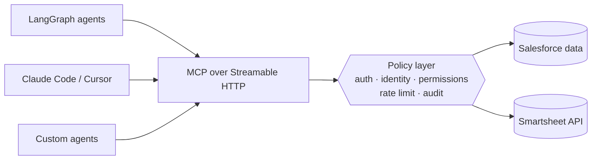
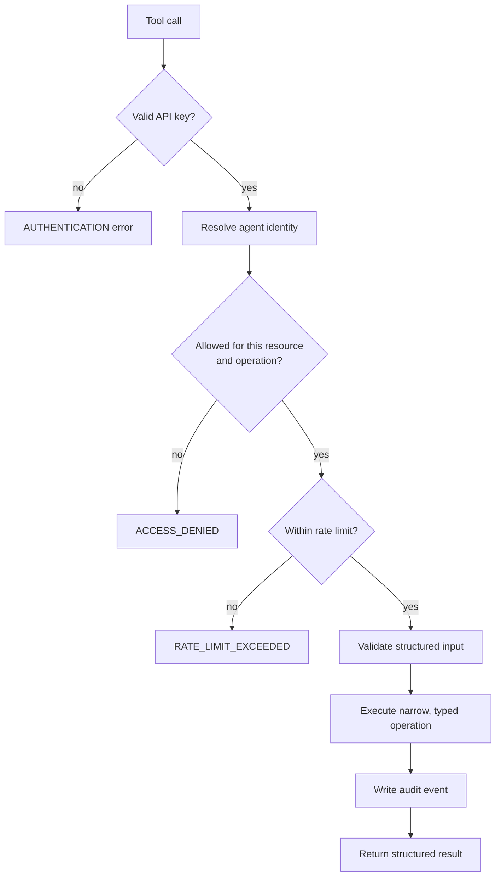

# Enterprise MCP Layer: Salesforce + Smartsheet MCP Servers

> Two standalone **Model Context Protocol (MCP)** servers that let AI agents use business systems **without the LLM ever being the security boundary.** Both are deployed internally.


> **About the source code:** I built both servers at my current employer, IDeaS Revenue Solutions (hotel revenue-management software), and the code is proprietary. This repository documents the projects (architecture, security model, tools and engineering decisions) so I can walk through them in detail.

---

## The problem

Internal AI agents (LangGraph agents, Claude Code, Cursor) needed to read, and sometimes update, data in Salesforce and Smartsheet. Left alone, each agent would ship its own API client, credentials, retries and logging, with no way to answer *"which agent touched this record, and was it allowed to?"*

So I built **one controlled capability layer per system**. Agents speak MCP; the server decides what they may do.



---

## Request pipeline (both servers)

Every tool call goes through the same checks before any business system is touched:



---

## Server 1: Salesforce MCP

| | |
|---|---|
| **Tools** | 11 read-only CRM tools (write and placeholder tools deliberately removed for v1) |
| **Transport** | Official `mcp` Python SDK, Streamable HTTP, Starlette/Uvicorn |
| **Data path** | PostgreSQL replica of Salesforce data; live-SOQL fallback **off by default** and enabled per API key |
| **Control plane** | SQLite for API keys, rate limits and audit log; admin key management |
| **Deploy** | Docker Compose, internal network (v1.1) |

**What I found and fixed along the way:**
- **An authentication bypass in the reference implementation** I started from. I replaced it with a **fail-closed** key system: no key, bad key or disabled key means no access, with no anonymous fallback.
- **The backing database exposed 100+ tables** beyond what agents needed. I added **table-level allow-listing and query guards**, so agents can reach only the intended objects.

## Server 2: Smartsheet MCP

| | |
|---|---|
| **Read tools** | `search_sheets`, `get_sheet`, `get_columns`, `get_rows`, `get_row`, `find_in_sheet`, `get_reports`, `get_dashboards` |
| **Write tools** | `add_rows`, `update_rows`, subject to per-agent permission; **row deletion disabled by default** |
| **Agent identity** | Each API key maps to a named agent or application, with an owner, status, expiry and rate limit |
| **Resource registry** | Agents use stable IDs (e.g. `case_tracker`) instead of raw sheet IDs, which makes per-resource permissions possible |
| **Admin panel** | Keys, identities, resources, permissions, rate limits, usage metrics, recent calls and audit log |
| **Deploy** | Docker, with data mounted outside the container so keys and audit history survive rebuilds |

Example permission (per agent, per resource, per operation):

```json
{
  "agent": "support-agent",
  "resource": "case_tracker",
  "permissions": { "read": true, "add_rows": true, "update_rows": true, "delete_rows": false }
}
```

---

## Principles both servers follow

1. **The LLM is not the authorization layer.** The model can *ask*; the server decides.
2. **Least privilege.** Each agent gets only the resources and operations its workflow needs.
3. **Narrow, typed tools.** Structured parameters, never "let the model build an HTTP request".
4. **Read before write, explicit writes.** Validated fields only; non-idempotent writes are never blindly retried.
5. **Return less data.** Targeted retrieval and limits cut tokens, latency and exposure.
6. **Everything is auditable.** Every call records agent, tool, resource, decision and result, and secrets are never logged.
7. **Structured errors.** `INVALID_API_KEY`, `ACCESS_DENIED`, `RATE_LIMIT_EXCEEDED` and similar, so agents can recover without seeing internals.

## Connecting an agent

```bash
# Claude Code
claude mcp add --transport http smartsheet https://<host>/mcp --header "x-api-key: <key>"
```

```json
// Cursor / Claude Desktop
{ "mcpServers": { "smartsheet": { "url": "https://<host>/mcp", "headers": { "x-api-key": "<key>" } } } }
```

---

## Honest limits and what's next

- Both run on the **internal network only**; TLS, enterprise SSO and a secret manager come before any wider rollout.
- Human-approval workflows for high-risk writes are **designed, not yet built**.
- Next: OAuth per-user identity, row- and field-level permissions, webhooks and events, OpenTelemetry metrics.

## Stack

Python · MCP Python SDK · Streamable HTTP · Starlette / Uvicorn · PostgreSQL · SQLite · Docker / Docker Compose · Salesforce · Smartsheet API

## How I built it

Designed and built with **Claude Code** as my main development tool. I owned the security model and the checks each server has to pass before an agent is allowed to connect: missing, invalid, disabled and expired keys are rejected; unauthorized resources and operations are denied; rate limits trigger; audit records are written; and data survives container restarts.

---

*Shubham Jamdar · [LinkedIn](https://www.linkedin.com/in/shubham-jamdar-2571271b3) · [GitHub](https://github.com/Shubham261299)*
